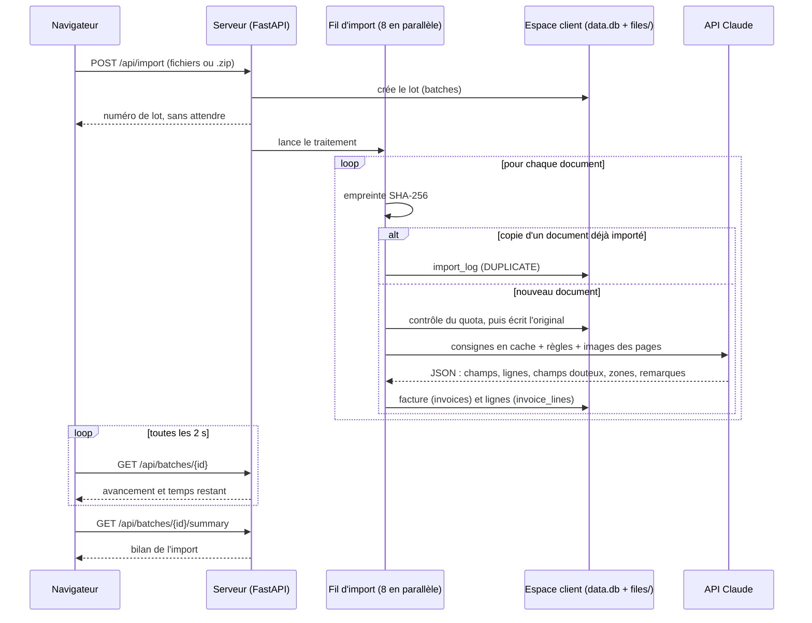

# The Bill Please — cahier des charges technique

Référence de l'existant · état au 27 octobre 2026

## 1. Objet et périmètre

Ce document décrit ce que fait The Bill Please, ce qu'il doit garantir, et comment c'est construit.
Il s'adresse aux personnes qui développent l'application.

**État décrit :** la branche `main` (commit `23d0c3e`), plus la PR #4 « Refonte Brume : page
Factures » (commit `5a2ec93`). La PR #4 n'est pas encore fusionnée ; ce document est à fusionner
après elle.

**Lien avec `CLAUDE.md`.** `CLAUDE.md` est le guide de développement : il explique *pourquoi* le
code est écrit ainsi et ce qu'il ne faut pas casser. Ce document énonce *ce que* l'application doit
faire, sous forme d'exigences numérotées et vérifiables, et renvoie à `CLAUDE.md` pour le détail.
En cas de désaccord entre les deux, c'est le code qui fait foi, et l'un des deux documents est à
corriger.

**Documents de septembre.** Les trois PDF de `docs/` restent des documents datés. Voici ce qui a
changé depuis :

| Sujet | Septembre 2026 (PDF) | Aujourd'hui |
|---|---|---|
| Doublons | table `duplicates`, panneau « Doublons ignorés » sur la page Invoices | journal `import_log` en base avec un code raison ; aucun panneau ni liste ; les doublons sont comptés dans le bilan d'import, la carte « Dernier import » de l'accueil et `manage.py storage` |
| Réponse de l'automate | `max_tokens` 2 048 | 8 192 (les lignes de facture d'une facture de 40 lignes tronquaient la réponse) |
| Contenu extrait | champs d'en-tête, champs douteux, remarques | en plus : lignes de facture, zone de chaque champ douteux sur la page |
| Vérification | tableau éditable, visionneuse du document en fenêtre | liste / détail, visionneuse zoomable qui entoure les zones douteuses, confirmation et validation |
| Apprentissage | à partir des corrections | à partir des corrections et des confirmations |
| Accueil | tableau de bord avec filtres | accueil sans filtre : dernier mois complet, 12 mois, heatmap, alertes de prix, dernières factures |
| Tests | une suite de sécurité est mentionnée | elle n'est pas dans le dépôt (voir section 8) |

## 2. Acteurs

- **Utilisateur d'un espace client.**
  - Il a un compte (adresse e-mail et mot de passe) dans un espace client.
  - Il importe, vérifie, corrige et exporte les factures de cet espace, et uniquement de
    celui-là.
  - Tous les comptes d'un espace ont les mêmes droits : il n'y a pas de rôles.
- **Administrateur de la plateforme.**
  - Il agit en ligne de commande sur le serveur, avec `manage.py`.
  - Il crée les espaces clients et les comptes, change les mots de passe, consulte l'espace
    occupé et fixe les quotas.
  - Il n'a pas d'interface web.
- **Premier utilisateur d'un espace vide.** Tant qu'un espace n'a aucun compte, la page
  `/setup` permet d'y créer le premier.

## 3. Exigences fonctionnelles

Chaque exigence est numérotée `EF-<domaine>-<n>`. La section 8 indique le test qui la vérifie.

### 3.1 Import (`IMP`)

- **EF-IMP-1** — L'application doit accepter en import des fichiers PDF, JPEG, PNG et WebP, ainsi que des archives `.zip` qui en contiennent.
  - Une archive peut en contenir d'autres, jusqu'à 3 niveaux d'imbrication.
- **EF-IMP-2** — L'application doit ignorer sans erreur les fichiers système des archives (`__MACOSX/`, fichiers cachés, `Thumbs.db`), et doit signaler comme erreur tout autre fichier qui n'est ni un document ni une archive.
- **EF-IMP-3** — L'application doit répondre à un import sans attendre l'extraction : le traitement se poursuit en arrière-plan et la page affiche la progression.
- **EF-IMP-4** — L'application doit afficher pendant un import le nombre de documents traités et une estimation du temps restant.
  - L'estimation part d'un temps mesuré par facture, puis suit le rythme observé une fois
    qu'une série complète de traitements est terminée.
- **EF-IMP-5** — L'application doit refuser un second import dans un espace qui a déjà un import en cours.
- **EF-IMP-6** — L'application doit reconnaître une copie exacte d'un document déjà importé (même empreinte SHA-256), y compris au sein du même import, et ne doit ni la stocker, ni l'envoyer à l'automate, ni la compter dans les totaux.
- **EF-IMP-7** — L'application doit permettre de relancer un document dont l'extraction a échoué en le réimportant, sauf si l'utilisateur a modifié cette ligne à la main.
- **EF-IMP-8** — L'application doit inscrire dans le journal `import_log` chaque fichier d'un import qui n'est pas devenu une facture valide, avec un code raison : `DUPLICATE`, `UNSUPPORTED`, `EXTRACTION`, `QUOTA` ou `OTHER`.
- **EF-IMP-9** — L'application doit afficher à la fin d'un import un bilan : intégrées, déjà importées, en erreur par type d'erreur, non traitées.
  - Le bilan doit rester proposé tant que l'utilisateur ne l'a pas fermé, même s'il a quitté
    la page entre-temps.
- **EF-IMP-10** — L'application doit détecter un import interrompu par un redémarrage du serveur et le signaler comme tel ; un nouvel import des mêmes fichiers doit reprendre là où il s'est arrêté, grâce à la détection des doublons.
- **EF-IMP-11** — L'application doit conserver l'original de chaque document importé et doit le rendre consultable depuis la facture.

### 3.2 Extraction (`EXT`)

- **EF-EXT-1** — L'application doit extraire de chaque document le fournisseur, le numéro de facture, la date, le montant total, la devise et le montant de TVA.
- **EF-EXT-2** — L'application doit rendre les dates au format `AAAA-MM-JJ`, les devises en code ISO 4217 et les montants en nombres.
- **EF-EXT-3** — L'application doit extraire les lignes de facture : libellé tel qu'imprimé, nom générique du produit, catégorie, quantité, unité normalisée, prix unitaire et total de ligne.
- **EF-EXT-4** — L'application doit marquer comme douteux chaque champ dont l'automate n'est pas sûr, et doit conserver une remarque lisible qui explique le doute.
- **EF-EXT-5** — L'application doit conserver, pour chaque champ douteux, la zone de la page où il se trouve, doit écarter toute zone invalide (page inexistante, surface nulle, champ non douteux), et doit ramener dans la page une zone qui en déborde.
- **EF-EXT-6** — L'application doit envoyer les 5 premières pages d'un document en un seul appel, pour que l'en-tête et le récapitulatif final soient lus ensemble.
  - Les pages suivantes sont ignorées sans remarque : un total imprimé en page 6 ou au-delà n'est pas lu.
- **EF-EXT-7** — L'application doit redresser une photo selon son orientation EXIF avant de l'envoyer, pour que les zones douteuses correspondent à l'image affichée.
- **EF-EXT-8** — L'application doit transformer un échec d'extraction (API indisponible, réponse vide ou invalide) en ligne en erreur, visible dans l'onglet « En erreur », plutôt que de perdre le document.
- **EF-EXT-9** — L'application doit appliquer, lors de chaque extraction, toutes les règles apprises de l'espace.

### 3.3 Accueil (`ACC`)

- **EF-ACC-1** — L'accueil doit afficher le total facturé du dernier mois complet (pas du mois en cours), dans la devise principale de ce mois, et doit lister les autres devises à côté sans les additionner.
- **EF-ACC-2** — L'accueil doit afficher le nombre de factures de ce mois et le nombre de factures à vérifier, avec un lien vers cette liste.
- **EF-ACC-3** — L'accueil doit afficher l'évolution du total mensuel sur 12 mois au plus, mois en cours compris, dans une seule devise.
- **EF-ACC-4** — L'accueil doit afficher une carte de chaleur des montants par jour et par fournisseur, limitée aux 12 premiers fournisseurs et aux 45 jours les plus récents.
  - Chaque case doit donner son montant au survol et dans une infobulle.
- **EF-ACC-5** — L'accueil doit afficher le dernier import (en cours, terminé ou interrompu), les trois plus fortes alertes de prix et les dernières factures importées.
- **EF-ACC-6** — L'accueil ne doit proposer aucun filtre : il porte toujours sur tout l'espace.

### 3.4 Factures (`FAC`)

- **EF-FAC-1** — La page Factures doit présenter la liste des factures à gauche et la facture sélectionnée à droite ; la sélection doit figurer dans l'adresse (`?id=`).
- **EF-FAC-2** — La page doit permettre de filtrer par recherche, fournisseur, période, statut (toutes, à vérifier, en erreur) et import, et de trier par date ou par montant, croissant ou décroissant.
  - Les compteurs des onglets de statut ignorent le filtre de statut.
- **EF-FAC-3** — La liste doit être paginée par 100 factures, et la pagination doit conserver filtres et tri.
- **EF-FAC-4** — La page doit afficher le document original page par page, avec zoom (de 0,5 à 4 fois la taille ajustée), déplacement à la souris, au doigt et au clavier, et passage d'une page à l'autre.
- **EF-FAC-5** — La visionneuse doit entourer sur le document la zone de chaque champ douteux, doit pouvoir centrer la zone suivante, et un clic sur une zone doit placer le curseur dans le champ correspondant.
- **EF-FAC-6** — L'utilisateur doit pouvoir corriger les six champs d'en-tête, et aucun autre champ ; la correction doit être enregistrée sur la facture dont la valeur a été saisie.
- **EF-FAC-7** — L'utilisateur doit pouvoir confirmer un champ douteux sans le modifier, ou valider la facture entière, ce qui confirme tous ses champs douteux ; une facture en erreur ne doit pas pouvoir être validée.
- **EF-FAC-8** — L'application doit exporter en Excel la liste filtrée et triée, avec le code couleur de la vérification : orange pour un champ douteux, vert pour un champ corrigé.
- **EF-FAC-9** — La page doit rester utilisable sur téléphone : le détail s'ouvre en plein écran avec un bouton retour, sans défilement horizontal de la page.

### 3.5 Produits (`PRO`)

- **EF-PRO-1** — La page Produits doit regrouper les lignes de facture par produit générique, fournisseur, unité et devise, et doit les ordonner par catégorie puis par produit.
- **EF-PRO-2** — L'application doit traiter comme un même produit les variantes de lecture d'un même libellé chez un même fournisseur (casse, accents, pluriel, unité lue différemment), et doit signaler un groupe dont l'unité a été lue de façon incohérente.
- **EF-PRO-3** — L'application doit fusionner deux orthographes d'un fournisseur seulement quand les mots de l'une, formes juridiques ôtées, sont inclus dans ceux de l'autre.
  - Cette fusion ne doit s'appliquer qu'à la page Produits.
- **EF-PRO-4** — Pour chaque groupe, la page doit afficher le prix unitaire moyen, minimum et maximum, le nombre de factures, et un lien vers la facture du prix minimum et du prix maximum.
- **EF-PRO-5** — La page doit signaler les groupes dont le prix maximum dépasse la moyenne de plus d'un seuil réglable (25 % par défaut, de 0 à 100 % par pas de 5 %), sans recharger la page, et les filtres doivent conserver ce seuil.
- **EF-PRO-6** — La page doit afficher l'historique du prix unitaire d'un produit choisi, fournisseur par fournisseur.

### 3.6 Règles apprises (`REG`)

- **EF-REG-1** — L'application doit enregistrer chaque correction et chaque confirmation d'un champ, avec sa valeur avant et après.
- **EF-REG-2** — L'application doit déduire des corrections et confirmations en attente une règle d'extraction par fournisseur (plus une règle globale), et doit affiner la règle existante plutôt que d'en ajouter une nouvelle.
- **EF-REG-3** — L'application doit lancer cet apprentissage automatiquement dès que 3 corrections ou confirmations sont en attente (`AUTO_LEARN_THRESHOLD`), et doit aussi permettre de le lancer à la main.
- **EF-REG-4** — L'application doit marquer comme traitées toutes les corrections analysées, même celles dont aucune règle n'a pu être tirée.
- **EF-REG-5** — L'utilisateur doit pouvoir consulter et supprimer les règles apprises.

### 3.7 Administration (`ADM`)

- **EF-ADM-1** — L'administrateur doit pouvoir lister les espaces clients avec leur espace occupé et leur quota (`manage.py tenants`).
- **EF-ADM-2** — L'administrateur doit pouvoir créer un espace client (`add-tenant`), y créer un compte (`add-user`) et changer le mot de passe d'un compte (`reset-password`).
- **EF-ADM-3** — L'administrateur doit pouvoir consulter le détail de l'espace occupé par un client (`storage`) et fixer son quota en Mo, 0 voulant dire illimité (`set-quota`).

## 4. Exigences non fonctionnelles

### 4.1 Performances et coûts (`PERF`)

- **ENF-PERF-1** — L'application doit traiter au plus 8 documents en parallèle (`MAX_CONCURRENT_EXTRACTIONS`), pour rester dans les limites de débit de l'API.
  - Mesure du 17 septembre 2026 sur 24 factures réelles :
    - environ 10 s par facture pour un traitement seul, dont 71 % passés dans l'appel à
      l'automate ;
    - 1,58 s par facture en lot, soit environ 31 min pour les 1 181 factures du jeu de
      référence.
  - Ces temps datent d'avant l'extraction des lignes de facture (27 septembre), qui a
    allongé les réponses de l'automate (section 7.1). Ils sont à remesurer ; l'estimation du
    temps restant (`ESTIMATED_SECONDS_PER_INVOICE` = 10 s) repose encore sur eux.
- **ENF-PERF-2** — L'application doit refaire jusqu'à 6 tentatives d'un appel en cas de surcharge de l'API (erreurs 429 et 529) avant de déclarer l'extraction en échec.
- **ENF-PERF-3** — L'application doit placer les consignes système, règles apprises comprises, en cache d'API : elles sont identiques pour toutes les factures d'un import.
  - Mesure de septembre : environ 7 $ économisés sur un lot de 1 181 factures.
- **ENF-PERF-4** — L'application doit limiter le nombre de règles injectées à 60 (`MAX_RULES_IN_PROMPT`), et doit réduire les images à 2 000 pixels sur le grand côté.
- **ENF-PERF-5** — L'application ne doit pas décompresser en mémoire les documents d'une archive avant qu'un traitement les prenne en charge : chaque document est lu à ce moment-là.
  - Exception : une archive imbriquée dans une autre est lue entière en mémoire au dépliage, et l'archive envoyée est conservée entière, compressée, pendant l'import.
- **ENF-PERF-6** — L'apprentissage des règles, qui est un appel bloquant de plusieurs secondes, doit s'exécuter hors de la boucle d'événements du serveur, pour ne pas figer les autres requêtes.

### 4.2 Stockage et quota (`STO`)

- **ENF-STO-1** — L'application doit mesurer l'espace occupé par un client sur le disque (originaux et fichiers SQLite, y compris `-wal` et `-shm`), et non en additionnant les tailles déclarées.
- **ENF-STO-2** — L'application doit refuser un import quand le quota est déjà atteint, et doit arrêter un import en cours au quota, en transformant chaque fichier refusé en ligne en erreur.
- **ENF-STO-3** — L'application ne doit pas recompresser les originaux : ils sont conservés à l'identique, pour garder leur valeur de copie fidèle.
  - Mesure de septembre : environ 1,1 Mo par facture et environ 2 Go par client et par an.
- **ENF-STO-4** — L'application doit refuser une requête d'import qui dépasse `MAX_UPLOAD_MB` (500 Mo par défaut).

### 4.3 Sécurité (`SEC`)

- **ENF-SEC-1** — L'application ne doit jamais insérer un texte venu d'un document (fournisseur, remarques, libellés) comme du HTML : seulement comme du texte.
- **ENF-SEC-2** — L'application doit envoyer une politique de sécurité du contenu qui interdit tout script en ligne ou tiers (`script-src 'self'`).
- **ENF-SEC-3** — L'application doit dériver le nom de stockage d'un original de l'identifiant de la facture, ne doit accepter qu'une extension de la forme `^\.[a-z0-9]{1,8}$`, et doit vérifier que le chemin final reste dans le dossier du client.
- **ENF-SEC-4** — L'application doit revérifier ce confinement avant de servir un original ou une page rendue, et ne doit servir dans le navigateur que les PDF et les images (JPEG, PNG, WebP).
- **ENF-SEC-5** — L'application doit refuser une session dont l'espace client n'est pas celui de l'adresse demandée, ou dont le compte n'existe plus.
- **ENF-SEC-6** — L'application doit vider la session avant d'en ouvrir une nouvelle à la connexion.
- **ENF-SEC-7** — L'application doit bloquer pendant 5 minutes un couple adresse e-mail + adresse IP après 5 échecs de connexion.
- **ENF-SEC-8** — L'application doit stocker les mots de passe hachés avec scrypt.
- **ENF-SEC-9** — L'application doit marquer le cookie de session `Secure` dès que `APP_DOMAIN` est défini, et doit le garder en `SameSite=Lax`, qui tient lieu de protection CSRF.
- **ENF-SEC-10** — L'application doit autoriser l'affichage dans un cadre de la même origine seulement (`SAMEORIGIN`, `frame-ancestors 'self'`), jamais `DENY` ni `'none'`.
- **ENF-SEC-11** — L'application doit interdire la mise en cache des réponses sous `/invoices`, `/api` et `/dashboard`, et des images de pages.
- **ENF-SEC-12** — L'application doit refuser la modification de tout champ hors des six champs d'en-tête modifiables (`db.EDITABLE_FIELDS`).

### 4.4 Isolation des clients (`ISO`)

- **ENF-ISO-1** — Chaque espace client doit avoir sa propre base SQLite et son propre dossier de fichiers, sans table partagée ni colonne d'espace.
- **ENF-ISO-2** — L'application doit déterminer l'espace client à partir de l'adresse demandée (sous-domaine de `APP_DOMAIN`), et un sous-domaine inconnu doit recevoir une erreur 404 au lieu de créer un espace.
- **ENF-ISO-3** — L'application doit appliquer chaque évolution de schéma à toutes les bases existantes par des migrations additives, à la première ouverture de chaque base.

### 4.5 Compatibilité (`COMP`)

- **ENF-COMP-1** — L'application doit fonctionner sous Python 3.8 (version installée sur le poste de développement) : pas de syntaxe PEP 585 ou 604 évaluée à l'exécution, notamment dans les signatures des routes.
- **ENF-COMP-2** — L'application doit s'installer et se lancer sur un poste Windows par `Installer.bat` et `Lancer.bat`, sans ligne de commande.
- **ENF-COMP-3** — L'application doit fonctionner dans les navigateurs récents sur ordinateur et sur téléphone, sans étape de construction du front (une feuille de style, un script).

### 4.6 Conventions d'interface (`UI`)

- **ENF-UI-1** — L'interface ne doit jamais nommer le modèle : elle doit dire « l'automate ».
- **ENF-UI-2** — Tous les boutons doivent partager une même couleur ; le bleu doit être réservé aux liens et au focus.
- **ENF-UI-3** — L'interface doit respecter le réglage « réduire les animations » : les mouvements deviennent instantanés, et une action au clavier ne doit jamais être animée.
- **ENF-UI-4** — La couleur ne doit jamais être le seul moyen de lire une information : chaque case de la carte de chaleur porte aussi sa valeur en texte, et sa rampe de couleurs doit décroître en luminosité.
- **ENF-UI-5** — L'application doit référencer la feuille de style et le script avec un numéro de version (`static_url`), pour qu'une mise à jour ne laisse pas l'ancien script en cache.

## 5. Architecture

Une seule application Python (FastAPI) sert tous les clients. Les pages sont rendues côté serveur
(Jinja), avec une feuille de style et un script, sans étape de construction. L'import tourne dans
un fil d'exécution du même processus : il n'y a ni file de messages, ni service séparé.
`CLAUDE.md` détaille chaque choix.

### 5.1 Modules

| Module | Rôle |
|---|---|
| `app.py` | Routes web et API, pages, session, en-têtes de sécurité, export Excel à la demande |
| `config.py` | Réglages lus dans l'environnement ; secret de session généré et conservé en local |
| `tenants.py` | Registre des espaces clients (le système de fichiers sert de registre), résolution de l'espace depuis l'adresse, mesure de l'espace occupé |
| `auth.py` | Hachage scrypt des mots de passe, blocage après échecs de connexion |
| `db.py` | Schéma, migrations additives et requêtes, base par base |
| `pipeline.py` | Import en arrière-plan : empreinte, doublons, quota, stockage, extraction parallèle, temps restant |
| `extraction.py` | Dépliage des archives, conversion en images, appel à l'API qui transforme un document en champs |
| `learning.py` | Corrections et confirmations → règles d'extraction |
| `documents.py` | Nombre de pages d'un original, rendu PNG d'une page pour la visionneuse (200 dpi) |
| `dashboard.py` | Calculs purs de l'accueil : dernier mois complet, fenêtre de 12 mois, devise principale, alertes |
| `products.py` | Calculs purs de la page Produits : regroupement, variantes, fusion des fournisseurs, dérive des prix |
| `charts.py` | Géométrie des graphiques (échelles, barres, carte de chaleur, nuage de prix) |
| `excel_export.py` | Export Excel coloré comme la vérification |
| `manage.py` | Administration en ligne de commande |

### 5.2 Parcours d'une facture



Un échec d'extraction devient une ligne en erreur dans `invoices`, inscrite aussi dans
`import_log` (raison `EXTRACTION`, `UNSUPPORTED`, `QUOTA` ou `OTHER`).

### 5.3 Modèle de données

Chaque espace client a sa propre base `data.db`, avec les mêmes tables. Les colonnes ajoutées
après coup sont aussi déclarées dans `db.MIGRATIONS`, qui les ajoute aux bases existantes.

| Table | Contenu | Colonnes clés |
|---|---|---|
| `users` | Comptes de l'espace | `email` (unique, sans casse), `password_hash` |
| `batches` | Un lot par import, et son avancement | `total`, `done`, `failed`, `duplicates`, `status` (`running`, `done`, `error`, `interrupted`), `started_by`, `acknowledged_at` (bilan fermé) |
| `invoices` | Une ligne par document importé : champs extraits, doutes, corrections, provenance | les six champs d'en-tête, `uncertain_fields`, `uncertain_regions`, `edited_fields` (listes JSON), `error`, `content_sha256`, `stored_name`, `page_count`, `batch_id`, `archive`, `filename` |
| `invoice_lines` | Une ligne par article facturé | `invoice_id`, `label`, `product_key`, `category`, `quantity`, `unit`, `unit_price`, `line_total` |
| `corrections` | Journal des corrections et confirmations | `field`, `old_value`, `new_value`, `kind` (`correction` ou `confirmation`), `learned`, `supplier_name` |
| `learned_rules` | Une règle par fournisseur, plus une règle globale | `supplier_name` (vide pour la règle globale, unique), `rule`, `based_on` |
| `import_log` | Chaque fichier d'un import qui n'est pas devenu une facture valide | `reason`, `message`, `duplicate_of`, `invoice_id`, `filename`, `archive` |
| `duplicates` | **Obsolète.** Ancien journal des doublons, recopié une fois dans `import_log` puis plus jamais écrit ; gardé pour les bases existantes | `filename`, `duplicate_of` |

À côté de la base, `files/` contient les originaux, nommés `<id de la facture><extension>`, et
`tenant.json` contient le nom affiché et le quota de l'espace.

### 5.4 Dépendance à l'API Claude

L'application appelle l'API Anthropic à deux endroits seulement :

- **l'extraction**, un appel par document ;
- **l'apprentissage**, un appel par fournisseur ayant des corrections en attente, sans image.

| Paramètre | Valeur | Où |
|---|---|---|
| Modèle d'extraction | `claude-sonnet-5` | `extraction.MODEL` |
| Modèle d'apprentissage | `claude-sonnet-5` | `learning.RULE_MODEL` |
| Réflexion | désactivée | il s'agit de lire, pas de raisonner : coût et durée prévisibles |
| Réponse maximale | 8 192 jetons (extraction), 400 (apprentissage) | une facture de 40 lignes tronque la réponse en dessous |
| Format de réponse | schéma JSON strict (`INVOICE_SCHEMA`), passé par `extra_body` | le SDK 0.72.0 ne connaît pas encore `output_config` |
| Cache | consignes système marquées `cache_control`, relues à environ 0,1 fois le prix | identiques pour toutes les factures d'un import |
| Nouvelles tentatives | 6 (`max_retries=6`) | les 2 par défaut ne suffisaient pas lors des pics de surcharge |
| Images | PDF rendus à 150 dpi, grand côté limité à 2 000 pixels, 5 pages au plus | limite le coût par facture |

La clé API est lue dans la variable d'environnement `ANTHROPIC_API_KEY` (fichier `.env`, exclu du
dépôt). Elle n'est jamais transmise au navigateur. Les documents envoyés quittent le serveur pour
l'API d'Anthropic : la note RGPD de septembre décrit les engagements d'Anthropic et ce qui reste à
contractualiser.

## 6. Hypothèses et limites connues

### 6.1 Hypothèses inscrites dans le code

- **Un document égale une facture.** Un PDF qui en regroupe plusieurs n'en restitue qu'une, avec
  une remarque.
- **Le fournisseur est l'émetteur de la facture, pas le client.** Le nom du dossier d'une archive
  n'est pas utilisé comme indice : l'extraction ne s'appuie que sur le document.
- **Numéro de facture :** il vient d'un champ INVOICE NUMBER ou CV INVOICE NUMBER, jamais d'un
  RECEIPT NUMBER. Ce n'est jamais non plus le long numéro fiscal (KRA) imprimé près du code-barres
  des factures kényanes du jeu de référence.
- **Formats normalisés par les consignes, pas en Python :** dates `AAAA-MM-JJ`, devises ISO 4217,
  montants en nombres.
- **Champs modifiables :** `db.EDITABLE_FIELDS` fait autorité sur ce qu'un utilisateur peut
  modifier (`ENF-SEC-12`). La provenance (nom du fichier, archive, identifiants) ne l'est jamais.

### 6.2 Limites connues

- **Pas d'hébergement.** L'application s'installe sur un poste Windows. Sa mise en production
  (domaine, HTTPS, sauvegardes, hébergeur européen) est décrite dans la note de septembre, pas
  réalisée.
- **Un seul processus.**
  - L'import vit dans le processus web : un redémarrage l'interrompt (`EF-IMP-10`).
  - Plusieurs serveurs en parallèle ne sont pas possibles.
  - Les écritures SQLite concurrentes expliquent l'essentiel de l'écart entre 1,58 s et 1,25 s
    par facture en lot.
- **Anciens imports incomplets.** Les lignes de facture et les zones douteuses ne s'appliquent
  qu'aux imports faits après leur arrivée. La détection des doublons empêche de réimporter les
  mêmes fichiers, et aucune ré-extraction n'existe.
- **Plusieurs devises.** Les montants de devises différentes ne sont jamais convertis ni
  additionnés : chaque vue en affiche une seule et signale les autres.
- **Comptes.** Ils se gèrent en ligne de commande uniquement : pas de mot de passe oublié, pas de
  double authentification, pas de rôles.
- **Points ouverts relevés par la note de sécurité de septembre :**
  - les archives piégées (bombes de décompression) ne sont pas détectées ;
  - l'export Excel charge jusqu'à 100 000 lignes en mémoire ;
  - il n'y a ni journal d'audit consultable, ni antivirus, ni chiffrement applicatif au repos.
- **Page Produits :** elle n'a pas encore reçu la refonte visuelle des autres pages.
- **Petits défauts différés de la PR #4** :
  - un numéro de page non entier renvoie 422 au lieu de 404 ;
  - un PDF dont une page ne se rend pas renvoie 500, et les anciens cadres restent affichés ;
  - « Ouvrir l'original » reste visible quand le fichier a disparu du disque ;
  - le surlignage d'un cadre ne s'efface pas au départ de la souris ;
  - après un pincement, un doigt seul ne déplace plus la page ;
  - la visionneuse n'est pas remesurée à l'ouverture du détail sur téléphone ;
  - deux confirmations très rapides peuvent se chevaucher ;
  - un champ confirmé puis corrigé envoie les deux signaux à l'apprentissage ;
  - quelques finitions d'accessibilité et de navigation dans la liste.
- **Tests de sécurité absents du dépôt.** `CLAUDE.md` et la note de septembre citent une suite de
  tests de sécurité qui n'est pas dans le dépôt. Les exigences `ENF-SEC` sans test sont marquées
  « non couverte » en section 8.

## 7. Coût par facture et capacité restante

L'application consomme le **crédit API** du compte Anthropic auquel appartient la clé du `.env`.
C'est un crédit prépayé en dollars, distinct de tout abonnement Claude (Pro, Max). Le crédit
restant se lit sur la Console Anthropic, page de facturation.

### 7.1 Estimation

Le coût ci-dessous est **calculé, pas mesuré** : aucune clé API n'a été utilisée pour rédiger ce
document. Il combine les volumes de jetons mesurés en septembre avec le tarif public du modèle.

**Tarif de `claude-sonnet-5`**, relevé le 27 octobre 2026 sur
[la page de tarifs d'Anthropic](https://platform.claude.com/docs/en/about-claude/pricing), en
dollars par million de jetons :

| Entrée | Sortie | Écriture du cache (5 min) | Lecture du cache |
|---|---|---|---|
| 2 $ | 10 $ | 2,50 $ | 0,20 $ |

**Volumes retenus :**

- **images :** environ 2 900 jetons par page (mesure de septembre, rendu à 150 dpi, inchangé) ;
- **consignes système :** 1 270 jetons sans règle, environ 1 850 avec 5 règles, environ 6 900
  avec 60 règles. Elles sont relues depuis le cache à partir de la deuxième facture d'un import ;
- **réponse :** dépend surtout du nombre de lignes de facture. La mesure documentée dans
  `CLAUDE.md` est d'un demi-centime à un centime de sortie par facture, soit 500 à 1 000 jetons.

| Cas | Hypothèses | Coût par facture |
|---|---|---|
| Bas | 1 page, aucune règle, réponse de 600 jetons | **0,012 $** |
| Typique | 1 page, 5 règles, réponse de 1 000 jetons | **0,016 $** |
| Haut | 3 pages, 60 règles, facture de 40 lignes (réponse de 3 000 jetons) | **0,049 $** |

La réponse représente environ 60 % du coût dans les cas typique et haut. Le cas haut dépasse volontairement la fourchette mesurée : c'est une facture longue,
pas une facture courante.

Les premiers appels d'un import paient l'écriture du cache au lieu de sa lecture : de 0,3 à
1,6 centime de plus chacun. Avec 8 traitements en parallèle, jusqu'à 8 appels de la première
série le paient, soit au plus une dizaine de centimes par import. Les appels d'apprentissage (un par fournisseur
corrigé, sans image, réponse de 400 jetons au plus) coûtent une fraction de centime chacun et sont
rares à côté des extractions.

**Comparaison avec septembre.** La note de septembre estimait « 10 à 12 € pour 1 000 factures »,
soit 1 à 1,2 centime d'euro par facture. C'était avant l'extraction des lignes de facture, qui
a allongé les réponses. Le cas typique d'aujourd'hui, environ 16 $ pour 1 000 factures, est cohérent
avec cette évolution.

### 7.2 Capacité restante

```
factures restantes ≈ crédit restant ÷ coût par facture
```

| Crédit restant | Cas bas | Cas typique | Cas haut |
|---|---|---|---|
| 10 $ | ~820 | ~610 | ~200 |
| 50 $ | ~4 110 | ~3 070 | ~1 020 |
| 100 $ | ~8 230 | ~6 150 | ~2 040 |

Les doublons ne coûtent rien : ils sont écartés avant l'appel à l'API (`EF-IMP-6`). Un lot de
1 181 factures comme le jeu de référence coûte donc environ 19 $ dans le cas typique.

### 7.3 Mesure réelle

L'application ne relève pas encore les jetons réellement consommés : la réponse de l'API les
indique pourtant à chaque appel. Une fonctionnalité dédiée est prévue, avec sa propre conception.
Elle relèvera ces jetons, affichera un coût moyen mesuré et remplacera cette estimation.

## 8. Traçabilité

Sur 82 exigences, **30** sont vérifiées par au moins un test du dépôt, dont 14 entièrement ; **52** ne le sont pas.
Les tests cités sont ceux de la branche de la PR #4 (75 tests, `pytest -q`).

Trois remarques pour lire ce tableau :

- **Sécurité.** `CLAUDE.md` et la note de septembre citent une suite de tests de sécurité (cloisonnement entre clients, sessions, service des fichiers, imports). Elle n'est pas dans le dépôt : les exigences `ENF-SEC` qu'elle couvrait sont marquées non couvertes, ce qui veut dire *non vérifiées par un test présent*, pas *non respectées*.
- **Navigateur.** Le comportement de la page Factures (sélection, visionneuse, zones, téléphone) a été vérifié par des contrôles Playwright pendant la PR #4. Ces scripts ne sont pas dans le dépôt, donc ils ne comptent pas ici.
- **Automate.** Ce que l'automate lit sur un document (`EF-EXT-1` à `EF-EXT-4`) dépend du modèle et des consignes ; aucun test du dépôt ne le vérifie sans appel réel à l'API.

| Exigence | Test(s) |
|---|---|
| EF-IMP-1 | **non couverte** |
| EF-IMP-2 | `tests/test_import_log.py::test_unsupported_file_is_logged_and_kept_as_error_row` (partielle : fichiers système non testés) |
| EF-IMP-3 | **non couverte** |
| EF-IMP-4 | `tests/test_home_route.py::test_running_import_shows_time_remaining` (partielle : affichage seulement, pas le calcul) |
| EF-IMP-5 | **non couverte** |
| EF-IMP-6 | `tests/test_import_log.py::test_duplicate_in_same_archive_is_logged` (partielle : copie d'un import précédent et exclusion des totaux non testées) |
| EF-IMP-7 | **non couverte** |
| EF-IMP-8 | `tests/test_import_log.py::test_reason_for_error`, `tests/test_import_log.py::test_duplicate_in_same_archive_is_logged`, `tests/test_import_log.py::test_unsupported_file_is_logged_and_kept_as_error_row`, `tests/test_import_log.py::test_failed_extraction_is_logged` |
| EF-IMP-9 | `tests/test_import_log.py::test_batch_summary_counts_duplicates_from_log` (partielle : seuls les doublons du bilan sont testés ; intégrées, erreurs par type, non traitées et reproposition ne le sont pas) |
| EF-IMP-10 | **non couverte** |
| EF-IMP-11 | `tests/test_pages_route.py::test_pdf_page_is_rendered_as_png` (partielle : la route `/file` n'est pas testée) |
| EF-EXT-1 | **non couverte** (comportement de l'automate) |
| EF-EXT-2 | **non couverte** (comportement de l'automate) |
| EF-EXT-3 | **non couverte** (comportement de l'automate) |
| EF-EXT-4 | **non couverte** (comportement de l'automate) |
| EF-EXT-5 | `tests/test_regions.py::test_regions_keep_only_uncertain_fields`, `tests/test_regions.py::test_regions_drop_pages_out_of_range_and_empty_boxes`, `tests/test_regions.py::test_regions_are_clamped_to_the_page`, `tests/test_regions.py::test_regions_ignore_garbage`, `tests/test_regions.py::test_schema_requires_regions`, `tests/test_regions.py::test_insert_invoice_stores_regions` |
| EF-EXT-6 | **non couverte** |
| EF-EXT-7 | `tests/test_photo_orientation.py::test_large_rotated_photo_is_sent_upright`, `tests/test_photo_orientation.py::test_small_rotated_photo_is_sent_upright`, `tests/test_photo_orientation.py::test_upright_photo_is_passed_through` |
| EF-EXT-8 | `tests/test_import_log.py::test_failed_extraction_is_logged` |
| EF-EXT-9 | **non couverte** |
| EF-ACC-1 | `tests/test_home_route.py::test_home_shows_last_complete_month_only`, `tests/test_home_route.py::test_home_other_currency_is_a_chip_not_a_sum`, `tests/test_dashboard.py::test_last_complete_month_regular`, `tests/test_dashboard.py::test_last_complete_month_january`, `tests/test_dashboard.py::test_main_currency_by_count` |
| EF-ACC-2 | `tests/test_db_home.py::test_count_uncertain_ignores_errors` (partielle : le compte de factures du mois n'est pas testé) |
| EF-ACC-3 | `tests/test_dashboard.py::test_month_window_includes_current_month_and_crosses_year`, `tests/test_charts.py::test_monthly_columns_marks_current_month`, `tests/test_db_home.py::test_monthly_series_fills_missing_months` |
| EF-ACC-4 | `tests/test_charts.py::test_heatmap_tooltip_data`, `tests/test_home_route.py::test_heatmap_never_mixes_currencies_when_window_is_empty` (partielle : limites de 12 fournisseurs et 45 jours non testées) |
| EF-ACC-5 | `tests/test_home_route.py::test_home_lists_three_latest_imports`, `tests/test_dashboard.py::test_top_price_alerts_keeps_three_highest_drifts`, `tests/test_db_home.py::test_latest_batch_none_then_most_recent`, `tests/test_home_route.py::test_running_import_shows_time_remaining` |
| EF-ACC-6 | `tests/test_home_route.py::test_home_has_no_filters_and_no_scale_toggle` |
| EF-FAC-1 | `tests/test_invoice_list.py::test_page_lists_rows_with_state_and_has_detail_pane` (partielle : la sélection dans l'adresse est du JavaScript, non testé) |
| EF-FAC-2 | `tests/test_invoice_list.py::test_sort_orders_put_missing_values_last`, `tests/test_invoice_list.py::test_status_counts_ignore_the_status_filter`, `tests/test_invoice_list.py::test_status_links_keep_other_filters` (partielle : le tri, les compteurs et les liens sont testés, pas les filtres eux-mêmes) |
| EF-FAC-3 | `tests/test_invoice_list.py::test_invoices_page_has_no_duplicates_panel_and_keeps_sort_in_pagination` |
| EF-FAC-4 | `tests/test_pages_route.py::test_pdf_page_is_rendered_as_png`, `tests/test_pages_route.py::test_page_out_of_range_is_404`, `tests/test_pages_route.py::test_api_detail_reports_pages_and_regions` (partielle : zoom et déplacement sont du JavaScript, non testé) |
| EF-FAC-5 | **non couverte** (JavaScript) |
| EF-FAC-6 | `tests/test_invoice_review.py::test_correcting_a_field_removes_its_region`, `tests/test_invoice_review.py::test_confirmed_then_corrected_field_is_marked_edited` (partielle : le rattachement de la saisie à la bonne facture est du JavaScript, non testé) |
| EF-FAC-7 | `tests/test_invoice_review.py::test_confirm_removes_doubt_and_region_and_records_confirmation`, `tests/test_invoice_review.py::test_validate_confirms_every_doubtful_field`, `tests/test_invoice_review.py::test_validate_refuses_an_invoice_in_error` |
| EF-FAC-8 | **non couverte** |
| EF-FAC-9 | **non couverte** (mise en page) |
| EF-PRO-1 | **non couverte** |
| EF-PRO-2 | **non couverte** |
| EF-PRO-3 | **non couverte** |
| EF-PRO-4 | **non couverte** |
| EF-PRO-5 | **non couverte** |
| EF-PRO-6 | **non couverte** |
| EF-REG-1 | `tests/test_invoice_review.py::test_confirm_removes_doubt_and_region_and_records_confirmation` (partielle : l'enregistrement d'une correction n'est vérifié qu'indirectement) |
| EF-REG-2 | `tests/test_learning.py::test_confirmations_are_described_as_such`, `tests/test_learning.py::test_rule_prompt_explains_confirmations` (partielle : la consigne envoyée seulement, pas l'affinage d'une règle) |
| EF-REG-3 | `tests/test_invoice_review.py::test_confirmations_reach_the_learning_threshold` |
| EF-REG-4 | **non couverte** |
| EF-REG-5 | **non couverte** |
| EF-ADM-1 | **non couverte** |
| EF-ADM-2 | **non couverte** |
| EF-ADM-3 | **non couverte** |
| ENF-PERF-1 | **non couverte** |
| ENF-PERF-2 | **non couverte** |
| ENF-PERF-3 | **non couverte** |
| ENF-PERF-4 | **non couverte** |
| ENF-PERF-5 | **non couverte** |
| ENF-PERF-6 | `tests/test_invoice_review.py::test_confirm_learns_off_the_event_loop`, `tests/test_invoice_review.py::test_correction_learns_off_the_event_loop` |
| ENF-STO-1 | **non couverte** |
| ENF-STO-2 | **non couverte** |
| ENF-STO-3 | **non couverte** |
| ENF-STO-4 | **non couverte** |
| ENF-SEC-1 | `tests/test_home_route.py::test_home_escapes_supplier_names` (partielle : accueil seulement ; le script et les autres pages ne sont pas testés) |
| ENF-SEC-2 | **non couverte** |
| ENF-SEC-3 | **non couverte** |
| ENF-SEC-4 | **non couverte** |
| ENF-SEC-5 | **non couverte** |
| ENF-SEC-6 | **non couverte** |
| ENF-SEC-7 | **non couverte** |
| ENF-SEC-8 | **non couverte** |
| ENF-SEC-9 | **non couverte** |
| ENF-SEC-10 | **non couverte** |
| ENF-SEC-11 | `tests/test_pages_route.py::test_pdf_page_is_rendered_as_png` (partielle : images de pages seulement) |
| ENF-SEC-12 | `tests/test_invoice_review.py::test_confirm_rejects_a_field_that_is_not_doubtful` (partielle : ce test passerait même sans le contrôle `EDITABLE_FIELDS`, car le champ refusé n'est pas douteux ; la route de correction n'est pas testée) |
| ENF-ISO-1 | **non couverte** |
| ENF-ISO-2 | **non couverte** |
| ENF-ISO-3 | `tests/test_migrations.py::test_old_database_gets_new_columns_and_log`, `tests/test_migrations.py::test_duplicates_are_copied_only_once` |
| ENF-COMP-1 | **non couverte** |
| ENF-COMP-2 | **non couverte** |
| ENF-COMP-3 | **non couverte** |
| ENF-UI-1 | **non couverte** |
| ENF-UI-2 | **non couverte** |
| ENF-UI-3 | **non couverte** |
| ENF-UI-4 | `tests/test_charts.py::test_heat_stops_lightness_strictly_decreases`, `tests/test_charts.py::test_heatmap_tooltip_data` |
| ENF-UI-5 | **non couverte** |
