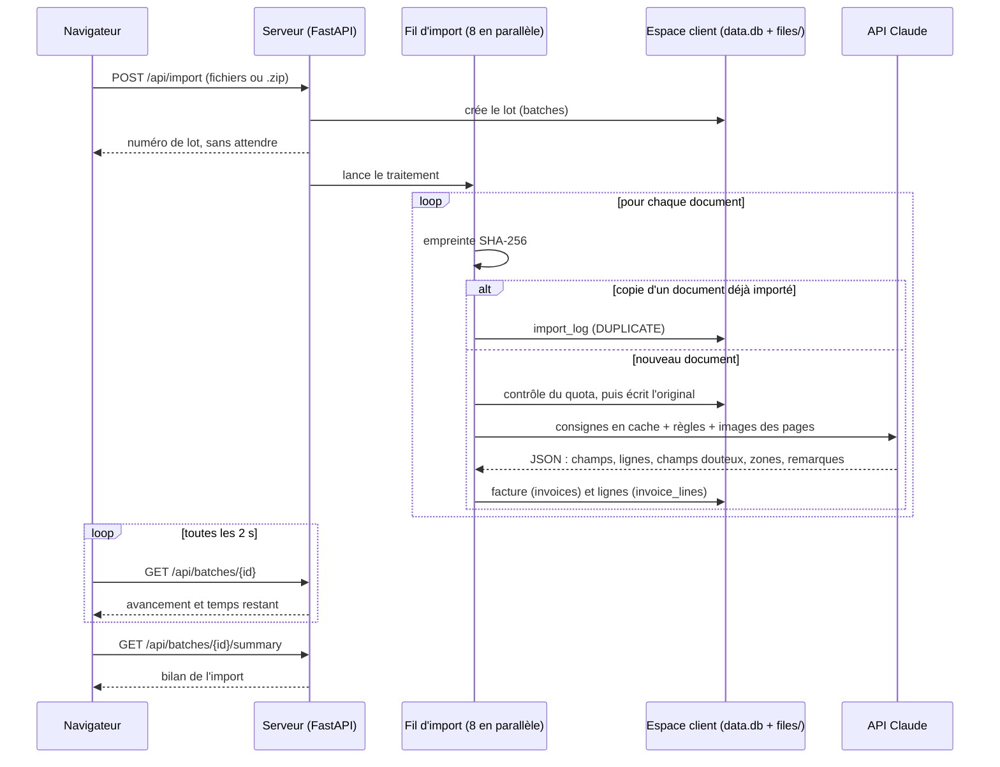

# Architecture, coût et limites techniques

Fait partie du [cahier des charges](README.md) · état au 27 octobre 2026 (`main` + PR #4).

## Architecture

Une seule application Python (FastAPI) sert tous les clients. Les pages sont rendues côté serveur
(Jinja), avec une feuille de style et un script, sans étape de construction. L'import tourne dans
un fil d'exécution du même processus : il n'y a ni file de messages, ni service séparé.
`CLAUDE.md` détaille chaque choix.

### Modules

| Module | Rôle |
|---|---|
| `app.py` | Routes web et API, pages, session, en-têtes de sécurité, export Excel à la demande |
| `config.py` | Réglages lus dans l'environnement ; secret de session généré et conservé en local |
| `tenants.py` | Registre des espaces clients (le système de fichiers sert de registre), résolution de l'espace depuis l'adresse, mesure de l'espace occupé |
| `auth.py` | Hachage scrypt des mots de passe, blocage après échecs de connexion |
| `db.py` | Schéma, migrations additives et requêtes, base par base |
| `pipeline.py` | Import en arrière-plan : empreinte, doublons, quota, stockage, extraction parallèle, temps restant |
| `extraction.py` | Dépliage des archives, conversion en images, appel à l'API qui transforme un document en champs |
| `learning.py` | Corrections et confirmations → règles d'extraction |
| `documents.py` | Nombre de pages d'un original, rendu PNG d'une page pour la visionneuse (200 dpi) |
| `dashboard.py` | Calculs purs de l'accueil : dernier mois complet, fenêtre de 12 mois, devise principale, alertes |
| `products.py` | Calculs purs de la page Produits : regroupement, variantes, fusion des fournisseurs, dérive des prix |
| `charts.py` | Géométrie des graphiques (échelles, barres, carte de chaleur, nuage de prix) |
| `excel_export.py` | Export Excel coloré comme la vérification |
| `manage.py` | Administration en ligne de commande |

### Parcours d'une facture



Un échec d'extraction devient une ligne en erreur dans `invoices`, inscrite aussi dans
`import_log` (raison `EXTRACTION`, `UNSUPPORTED`, `QUOTA` ou `OTHER`).

### Modèle de données

Chaque espace client a sa propre base `data.db`, avec les mêmes tables. Les colonnes ajoutées
après coup sont aussi déclarées dans `db.MIGRATIONS`, qui les ajoute aux bases existantes.

| Table | Contenu | Colonnes clés |
|---|---|---|
| `users` | Comptes de l'espace | `email` (unique, sans casse), `password_hash` |
| `batches` | Un lot par import, et son avancement | `total`, `done`, `failed`, `duplicates`, `status` (`running`, `done`, `error`, `interrupted`), `started_by`, `acknowledged_at` (bilan fermé) |
| `invoices` | Une ligne par document importé : champs extraits, doutes, corrections, provenance | les six champs d'en-tête, `uncertain_fields`, `uncertain_regions`, `edited_fields` (listes JSON), `error`, `content_sha256`, `stored_name`, `page_count`, `batch_id`, `archive`, `filename` |
| `invoice_lines` | Une ligne par article facturé | `invoice_id`, `label`, `product_key`, `category`, `quantity`, `unit`, `unit_price`, `line_total` |
| `corrections` | Journal des corrections et confirmations | `field`, `old_value`, `new_value`, `kind` (`correction` ou `confirmation`), `learned`, `supplier_name` |
| `learned_rules` | Une règle par fournisseur, plus une règle globale | `supplier_name` (vide pour la règle globale, unique), `rule`, `based_on` |
| `import_log` | Chaque fichier d'un import qui n'est pas devenu une facture valide | `reason`, `message`, `duplicate_of`, `invoice_id`, `filename`, `archive` |
| `duplicates` | **Obsolète.** Ancien journal des doublons, recopié une fois dans `import_log` puis plus jamais écrit ; gardé pour les bases existantes | `filename`, `duplicate_of` |

À côté de la base, `files/` contient les originaux, nommés `<id de la facture><extension>`, et
`tenant.json` contient le nom affiché et le quota de l'espace.

### Dépendance à l'API Claude

L'application appelle l'API Anthropic à deux endroits seulement :

- **l'extraction**, un appel par document ;
- **l'apprentissage**, un appel par fournisseur ayant des corrections en attente, sans image.

| Paramètre | Valeur | Où |
|---|---|---|
| Modèle d'extraction | `claude-sonnet-5` | `extraction.MODEL` |
| Modèle d'apprentissage | `claude-sonnet-5` | `learning.RULE_MODEL` |
| Réflexion | désactivée | il s'agit de lire, pas de raisonner : coût et durée prévisibles |
| Réponse maximale | 8 192 jetons (extraction), 400 (apprentissage) | une facture de 40 lignes tronque la réponse en dessous |
| Format de réponse | schéma JSON strict (`INVOICE_SCHEMA`), passé par `extra_body` | le SDK 0.72.0 ne connaît pas encore `output_config` |
| Cache | consignes système marquées `cache_control`, relues à environ 0,1 fois le prix | identiques pour toutes les factures d'un import |
| Nouvelles tentatives | 6 (`max_retries=6`) | les 2 par défaut ne suffisaient pas lors des pics de surcharge |
| Images | PDF rendus à 150 dpi, grand côté limité à 2 000 pixels, 5 pages au plus | limite le coût par facture |

La clé API est lue dans la variable d'environnement `ANTHROPIC_API_KEY` (fichier `.env`, exclu du
dépôt). Elle n'est jamais transmise au navigateur. Les documents envoyés quittent le serveur pour
l'API d'Anthropic : la note RGPD de septembre décrit les engagements d'Anthropic et ce qui reste à
contractualiser.

## Hypothèses et limites connues

### Hypothèses inscrites dans le code

- **Un document égale une facture.** Un PDF qui en regroupe plusieurs n'en restitue qu'une, avec
  une remarque.
- **Le fournisseur est l'émetteur de la facture, pas le client.** Le nom du dossier d'une archive
  n'est pas utilisé comme indice : l'extraction ne s'appuie que sur le document.
- **Numéro de facture :** il vient d'un champ INVOICE NUMBER ou CV INVOICE NUMBER, jamais d'un
  RECEIPT NUMBER. Ce n'est jamais non plus le long numéro fiscal (KRA) imprimé près du code-barres
  des factures kényanes du jeu de référence.
- **Formats normalisés par les consignes, pas en Python :** dates `AAAA-MM-JJ`, devises ISO 4217,
  montants en nombres.
- **Champs modifiables :** `db.EDITABLE_FIELDS` fait autorité sur ce qu'un utilisateur peut
  modifier (`ENF-SEC-12`). La provenance (nom du fichier, archive, identifiants) ne l'est jamais.

### Limites connues

- **Pas d'hébergement.** L'application s'installe sur un poste Windows. Sa mise en production
  (domaine, HTTPS, sauvegardes, hébergeur européen) est décrite dans la note de septembre, pas
  réalisée.
- **Un seul processus.**
  - L'import vit dans le processus web : un redémarrage l'interrompt (`EF-IMP-10`, [importation](fonctionnel/01-importation.md)).
  - Plusieurs serveurs en parallèle ne sont pas possibles.
  - Les écritures SQLite concurrentes expliquent l'essentiel de l'écart entre 1,58 s et 1,25 s
    par facture en lot.
- **Anciens imports incomplets.** Les lignes de facture et les zones douteuses ne s'appliquent
  qu'aux imports faits après leur arrivée. La détection des doublons empêche de réimporter les
  mêmes fichiers, et aucune ré-extraction n'existe.
- **Plusieurs devises.** Les montants de devises différentes ne sont jamais convertis ni
  additionnés : chaque vue en affiche une seule et signale les autres.
- **Comptes.** Ils se gèrent en ligne de commande uniquement : pas de mot de passe oublié, pas de
  double authentification, pas de rôles.
- **Points ouverts relevés par la note de sécurité de septembre :**
  - les archives piégées (bombes de décompression) ne sont pas détectées ;
  - l'export Excel charge jusqu'à 100 000 lignes en mémoire ;
  - il n'y a ni journal d'audit consultable, ni antivirus, ni chiffrement applicatif au repos.
- **Page Produits :** elle n'a pas encore reçu la refonte visuelle des autres pages.
- **Petits défauts différés de la PR #4** :
  - un numéro de page non entier renvoie 422 au lieu de 404 ;
  - un PDF dont une page ne se rend pas renvoie 500, et les anciens cadres restent affichés ;
  - « Ouvrir l'original » reste visible quand le fichier a disparu du disque ;
  - le surlignage d'un cadre ne s'efface pas au départ de la souris ;
  - après un pincement, un doigt seul ne déplace plus la page ;
  - la visionneuse n'est pas remesurée à l'ouverture du détail sur téléphone ;
  - deux confirmations très rapides peuvent se chevaucher ;
  - un champ confirmé puis corrigé envoie les deux signaux à l'apprentissage ;
  - quelques finitions d'accessibilité et de navigation dans la liste.
- **Tests de sécurité absents du dépôt.** `CLAUDE.md` et la note de septembre citent une suite de
  tests de sécurité qui n'est pas dans le dépôt. Les exigences `ENF-SEC` sans test sont marquées
  « non couverte » dans [le non fonctionnel](non-fonctionnel.md).

## Coût par facture et capacité restante

L'application consomme le **crédit API** du compte Anthropic auquel appartient la clé du `.env`.
C'est un crédit prépayé en dollars, distinct de tout abonnement Claude (Pro, Max). Le crédit
restant se lit sur la Console Anthropic, page de facturation.

### Estimation

Le coût ci-dessous est **calculé, pas mesuré** : aucune clé API n'a été utilisée pour rédiger ce
document. Il combine les volumes de jetons mesurés en septembre avec le tarif public du modèle.

**Tarif de `claude-sonnet-5`**, relevé le 27 octobre 2026 sur
[la page de tarifs d'Anthropic](https://platform.claude.com/docs/en/about-claude/pricing), en
dollars par million de jetons :

| Entrée | Sortie | Écriture du cache (5 min) | Lecture du cache |
|---|---|---|---|
| 2 $ | 10 $ | 2,50 $ | 0,20 $ |

**Volumes retenus :**

- **images :** environ 2 900 jetons par page (mesure de septembre, rendu à 150 dpi, inchangé) ;
- **consignes système :** 1 270 jetons sans règle, environ 1 850 avec 5 règles, environ 6 900
  avec 60 règles. Elles sont relues depuis le cache à partir de la deuxième facture d'un import ;
- **réponse :** dépend surtout du nombre de lignes de facture. La mesure documentée dans
  `CLAUDE.md` est d'un demi-centime à un centime de sortie par facture, soit 500 à 1 000 jetons.

| Cas | Hypothèses | Coût par facture |
|---|---|---|
| Bas | 1 page, aucune règle, réponse de 600 jetons | **0,012 $** |
| Typique | 1 page, 5 règles, réponse de 1 000 jetons | **0,016 $** |
| Haut | 3 pages, 60 règles, facture de 40 lignes (réponse de 3 000 jetons) | **0,049 $** |

La réponse représente environ 60 % du coût dans les cas typique et haut. Le cas haut dépasse volontairement la fourchette mesurée : c'est une facture longue,
pas une facture courante.

Les premiers appels d'un import paient l'écriture du cache au lieu de sa lecture : de 0,3 à
1,6 centime de plus chacun. Avec 8 traitements en parallèle, jusqu'à 8 appels de la première
série le paient, soit au plus une dizaine de centimes par import. Les appels d'apprentissage (un par fournisseur
corrigé, sans image, réponse de 400 jetons au plus) coûtent une fraction de centime chacun et sont
rares à côté des extractions.

**Comparaison avec septembre.** La note de septembre estimait « 10 à 12 € pour 1 000 factures »,
soit 1 à 1,2 centime d'euro par facture. C'était avant l'extraction des lignes de facture, qui
a allongé les réponses. Le cas typique d'aujourd'hui, environ 16 $ pour 1 000 factures, est cohérent
avec cette évolution.

### Capacité restante

```
factures restantes ≈ crédit restant ÷ coût par facture
```

| Crédit restant | Cas bas | Cas typique | Cas haut |
|---|---|---|---|
| 10 $ | ~820 | ~610 | ~200 |
| 50 $ | ~4 110 | ~3 070 | ~1 020 |
| 100 $ | ~8 230 | ~6 150 | ~2 040 |

Les doublons ne coûtent rien : ils sont écartés avant l'appel à l'API (`EF-IMP-6`). Un lot de
1 181 factures comme le jeu de référence coûte donc environ 19 $ dans le cas typique.

### Mesure réelle

L'application ne relève pas encore les jetons réellement consommés : la réponse de l'API les
indique pourtant à chaque appel. Une fonctionnalité dédiée est prévue, avec sa propre conception.
Elle relèvera ces jetons, affichera un coût moyen mesuré et remplacera cette estimation.
