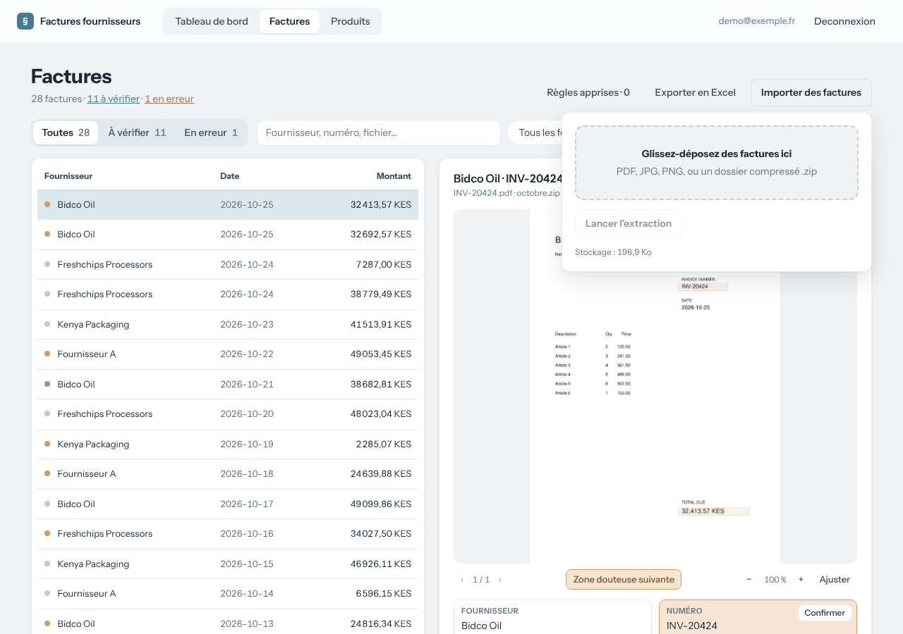
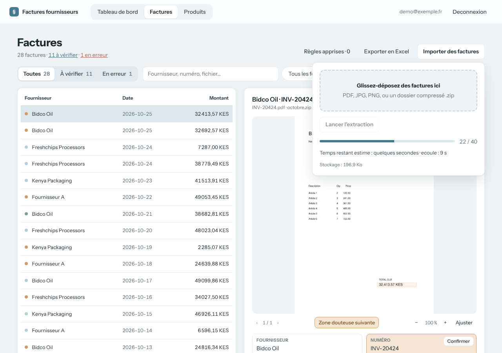
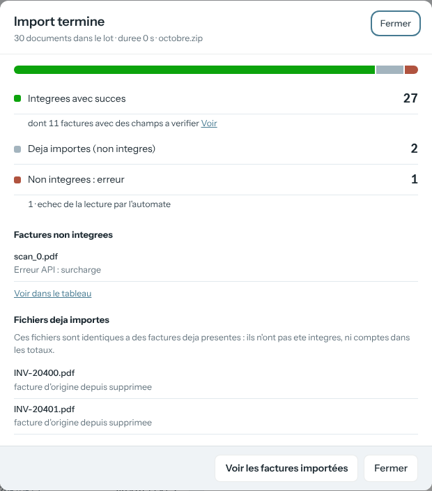

# Importation

Fait partie du [cahier des charges](../README.md) · état au 27 octobre 2026 (`main` + PR #4).

## Objectif

Faire entrer des centaines de factures en une fois, PDF, photos ou archives `.zip`, et en tirer les champs d'en-tête et les lignes d'articles, sans jamais compter deux fois le même fichier.

## Parcours

1. L'utilisateur ouvre le panneau d'import depuis la page Factures et y dépose ses fichiers.

2. Le serveur répond aussitôt ; l'automate lit les documents en arrière-plan, 8 à la fois. La page affiche l'avancement et le temps restant, y compris si l'utilisateur la quitte puis revient.

3. À la fin, un bilan dit ce qui a été intégré, ce qui était déjà importé et ce qui a échoué.

## Exigences

Chaque exigence indique le test du dépôt qui la vérifie, ou « non couverte ».

- **EF-IMP-1** — L'application doit accepter en import des fichiers PDF, JPEG, PNG et WebP, ainsi que des archives `.zip` qui en contiennent.
  - Une archive peut en contenir d'autres, jusqu'à 3 niveaux d'imbrication.
  - *Test :* **non couverte**
- **EF-IMP-2** — L'application doit ignorer sans erreur les fichiers système des archives (`__MACOSX/`, fichiers cachés, `Thumbs.db`), et doit signaler comme erreur tout autre fichier qui n'est ni un document ni une archive.
  - *Test :* `tests/test_import_log.py::test_unsupported_file_is_logged_and_kept_as_error_row` (partielle : fichiers système non testés)
- **EF-IMP-3** — L'application doit répondre à un import sans attendre l'extraction : le traitement se poursuit en arrière-plan et la page affiche la progression.
  - *Test :* **non couverte**
- **EF-IMP-4** — L'application doit afficher pendant un import le nombre de documents traités et une estimation du temps restant.
  - L'estimation part d'un temps mesuré par facture, puis suit le rythme observé une fois
    qu'une série complète de traitements est terminée.
  - *Test :* `tests/test_home_route.py::test_running_import_shows_time_remaining` (partielle : affichage seulement, pas le calcul)
- **EF-IMP-5** — L'application doit refuser un second import dans un espace qui a déjà un import en cours.
  - *Test :* **non couverte**
- **EF-IMP-6** — L'application doit reconnaître une copie exacte d'un document déjà importé (même empreinte SHA-256), y compris au sein du même import, et ne doit ni la stocker, ni l'envoyer à l'automate, ni la compter dans les totaux.
  - *Test :* `tests/test_import_log.py::test_duplicate_in_same_archive_is_logged` (partielle : copie d'un import précédent et exclusion des totaux non testées)
- **EF-IMP-7** — L'application doit permettre de relancer un document dont l'extraction a échoué en le réimportant, sauf si l'utilisateur a modifié cette ligne à la main.
  - *Test :* **non couverte**
- **EF-IMP-8** — L'application doit inscrire dans le journal `import_log` chaque fichier d'un import qui n'est pas devenu une facture valide, avec un code raison : `DUPLICATE`, `UNSUPPORTED`, `EXTRACTION`, `QUOTA` ou `OTHER`.
  - *Test :* `tests/test_import_log.py::test_reason_for_error`, `tests/test_import_log.py::test_duplicate_in_same_archive_is_logged`, `tests/test_import_log.py::test_unsupported_file_is_logged_and_kept_as_error_row`, `tests/test_import_log.py::test_failed_extraction_is_logged`
- **EF-IMP-9** — L'application doit afficher à la fin d'un import un bilan : intégrées, déjà importées, en erreur par type d'erreur, non traitées.
  - Le bilan doit rester proposé tant que l'utilisateur ne l'a pas fermé, même s'il a quitté
    la page entre-temps.
  - *Test :* `tests/test_import_log.py::test_batch_summary_counts_duplicates_from_log` (partielle : seuls les doublons du bilan sont testés ; intégrées, erreurs par type, non traitées et reproposition ne le sont pas)
- **EF-IMP-10** — L'application doit détecter un import interrompu par un redémarrage du serveur et le signaler comme tel ; un nouvel import des mêmes fichiers doit reprendre là où il s'est arrêté, grâce à la détection des doublons.
  - *Test :* **non couverte**
- **EF-IMP-11** — L'application doit conserver l'original de chaque document importé et doit le rendre consultable depuis la facture.
  - *Test :* `tests/test_pages_route.py::test_pdf_page_is_rendered_as_png` (partielle : la route `/file` n'est pas testée)
- **EF-IMP-12** — L'application doit extraire de chaque document le fournisseur, le numéro de facture, la date, le montant total, la devise et le montant de TVA.
  - *Test :* **non couverte** (comportement de l'automate)
- **EF-IMP-13** — L'application doit rendre les dates au format `AAAA-MM-JJ`, les devises en code ISO 4217 et les montants en nombres.
  - *Test :* **non couverte** (comportement de l'automate)
- **EF-IMP-14** — L'application doit extraire les lignes de facture : libellé tel qu'imprimé, nom générique du produit, catégorie, quantité, unité normalisée, prix unitaire et total de ligne.
  - *Test :* **non couverte** (comportement de l'automate)
- **EF-IMP-15** — L'application doit marquer comme douteux chaque champ dont l'automate n'est pas sûr, et doit conserver une remarque lisible qui explique le doute.
  - *Test :* **non couverte** (comportement de l'automate)
- **EF-IMP-16** — L'application doit conserver, pour chaque champ douteux, la zone de la page où il se trouve, doit écarter toute zone invalide (page inexistante, surface nulle, champ non douteux), et doit ramener dans la page une zone qui en déborde.
  - *Test :* `tests/test_regions.py::test_regions_keep_only_uncertain_fields`, `tests/test_regions.py::test_regions_drop_pages_out_of_range_and_empty_boxes`, `tests/test_regions.py::test_regions_are_clamped_to_the_page`, `tests/test_regions.py::test_regions_ignore_garbage`, `tests/test_regions.py::test_schema_requires_regions`, `tests/test_regions.py::test_insert_invoice_stores_regions`
- **EF-IMP-17** — L'application doit envoyer les 5 premières pages d'un document en un seul appel, pour que l'en-tête et le récapitulatif final soient lus ensemble.
  - Les pages suivantes sont ignorées sans remarque : un total imprimé en page 6 ou au-delà n'est pas lu.
  - *Test :* **non couverte**
- **EF-IMP-18** — L'application doit redresser une photo selon son orientation EXIF avant de l'envoyer, pour que les zones douteuses correspondent à l'image affichée.
  - *Test :* `tests/test_photo_orientation.py::test_large_rotated_photo_is_sent_upright`, `tests/test_photo_orientation.py::test_small_rotated_photo_is_sent_upright`, `tests/test_photo_orientation.py::test_upright_photo_is_passed_through`
- **EF-IMP-19** — L'application doit transformer un échec d'extraction (API indisponible, réponse vide ou invalide) en ligne en erreur, visible dans l'onglet « En erreur », plutôt que de perdre le document.
  - *Test :* `tests/test_import_log.py::test_failed_extraction_is_logged`
- **EF-IMP-20** — L'application doit appliquer, lors de chaque extraction, toutes les règles apprises de l'espace.
  - *Test :* **non couverte**

## Règles de gestion et cas limites

- **Doublon** : même empreinte SHA-256 que le fichier d'une facture déjà importée, ou qu'un fichier déjà pris en charge dans le même import. Une facture rescannée a une autre empreinte : ce n'est pas un doublon.
- **Relance** : une facture en erreur et jamais modifiée à la main est remplacée si l'on réimporte son fichier ; une facture modifiée à la main ne l'est jamais.
- **Quota** : vérifié avant l'import, puis fichier par fichier ; un fichier refusé devient une ligne en erreur (voir `ENF-STO-2`).
- **Ce que lit l'automate** : il s'appuie sur le document seul (le nom du dossier de l'archive n'est pas un indice), et suit les consignes et les règles apprises de l'espace (`EF-IMP-20`).

## Limites connues

- Seuls PDF, JPEG, PNG et WebP sont lus : une photo d'iPhone au format HEIC est refusée.
- Seules les 5 premières pages d'un document sont lues.
- Les doublons sont reconnus à l'identique seulement : une facture rescannée ou rephotographiée est comptée deux fois.
- Un document qui regroupe plusieurs factures n'en restitue qu'une, avec une remarque.
- Les lignes d'articles et les zones douteuses ne concernent que les imports faits depuis leur arrivée ; aucune ré-extraction n'existe.
- L'import vit dans le processus web : un redémarrage l'interrompt (`EF-IMP-10`).
- Les archives piégées (bombes de décompression) ne sont pas détectées.
- Les temps d'import mesurés en septembre précèdent la lecture des lignes et sont à remesurer (`ENF-PERF-1`).
