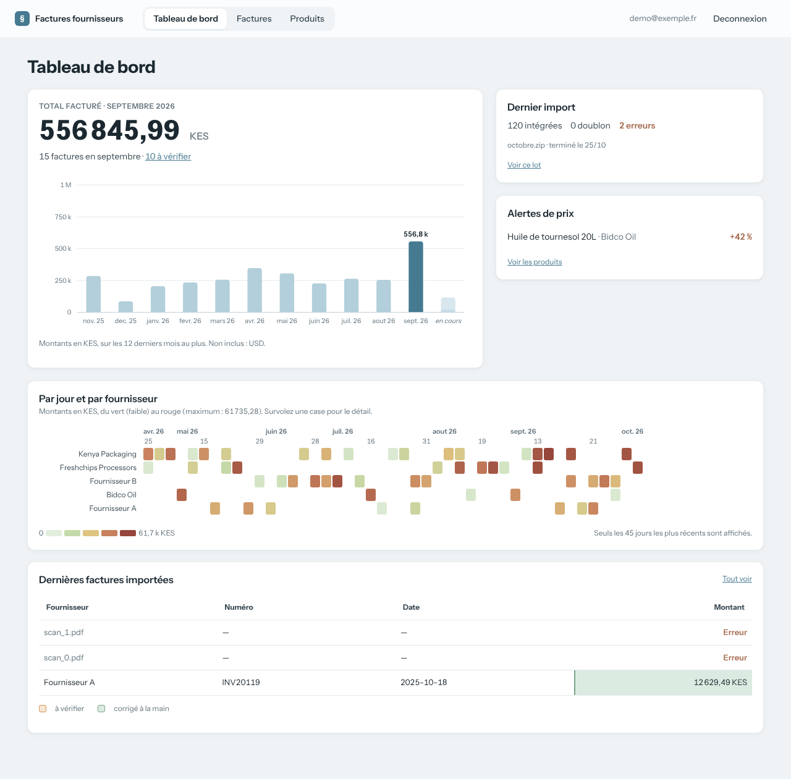

# Dashboard d'accueil

Fait partie du [cahier des charges](../README.md) · état au 27 octobre 2026 (`main` + PR #4).

## Objectif

Donner d'un coup d'œil l'état de l'espace : ce qui a été facturé, comment cela évolue, ce qui reste à vérifier.

## Parcours

L'utilisateur arrive sur l'accueil après connexion. Tout s'y lit sans réglage : il n'y a aucun filtre.

## Exigences

Chaque exigence indique le test du dépôt qui la vérifie, ou « non couverte ».

- **EF-ACC-1** — L'accueil doit afficher le total facturé du dernier mois complet (pas du mois en cours), dans la devise principale de ce mois, et doit lister les autres devises à côté sans les additionner.
  - *Test :* `tests/test_home_route.py::test_home_shows_last_complete_month_only`, `tests/test_home_route.py::test_home_other_currency_is_a_chip_not_a_sum`, `tests/test_dashboard.py::test_last_complete_month_regular`, `tests/test_dashboard.py::test_last_complete_month_january`, `tests/test_dashboard.py::test_main_currency_by_count`
- **EF-ACC-2** — L'accueil doit afficher le nombre de factures de ce mois et le nombre de factures à vérifier, avec un lien vers cette liste.
  - *Test :* `tests/test_db_home.py::test_count_uncertain_ignores_errors` (partielle : le compte de factures du mois n'est pas testé)
- **EF-ACC-3** — L'accueil doit afficher l'évolution du total mensuel sur 12 mois au plus, mois en cours compris, dans une seule devise.
  - *Test :* `tests/test_dashboard.py::test_month_window_includes_current_month_and_crosses_year`, `tests/test_charts.py::test_monthly_columns_marks_current_month`, `tests/test_db_home.py::test_monthly_series_fills_missing_months`
- **EF-ACC-4** — L'accueil doit afficher une carte de chaleur des montants par jour et par fournisseur, limitée aux 12 premiers fournisseurs et aux 45 jours les plus récents.
  - Chaque case doit donner son montant au survol et dans une infobulle.
  - *Test :* `tests/test_charts.py::test_heatmap_tooltip_data`, `tests/test_home_route.py::test_heatmap_never_mixes_currencies_when_window_is_empty` (partielle : limites de 12 fournisseurs et 45 jours non testées)
- **EF-ACC-5** — L'accueil doit afficher le dernier import (en cours, terminé ou interrompu), les trois plus fortes alertes de prix et les dernières factures importées.
  - *Test :* `tests/test_home_route.py::test_home_lists_three_latest_imports`, `tests/test_dashboard.py::test_top_price_alerts_keeps_three_highest_drifts`, `tests/test_db_home.py::test_latest_batch_none_then_most_recent`, `tests/test_home_route.py::test_running_import_shows_time_remaining`
- **EF-ACC-6** — L'accueil ne doit proposer aucun filtre : il porte toujours sur tout l'espace.
  - *Test :* `tests/test_home_route.py::test_home_has_no_filters_and_no_scale_toggle`

## Règles de gestion et cas limites

- **Devise principale** : celle qui compte le plus de factures sur la période ; en cas d'égalité, le plus gros montant.
- **Mois en cours** : il figure dans l'évolution mais jamais dans le grand chiffre, qui porte sur le dernier mois complet.
- **Carte de chaleur** : elle suit la devise de l'évolution ; si les 12 mois sont vides, celle de tout l'espace.
- Les factures en erreur et les dates illisibles ne comptent dans aucun total.

## Limites connues

- Les montants en devises différentes ne sont jamais additionnés : chaque vue en montre une et signale les autres.
- Le nombre « à vérifier » porte sur tout l'espace, pas seulement sur le mois affiché.
