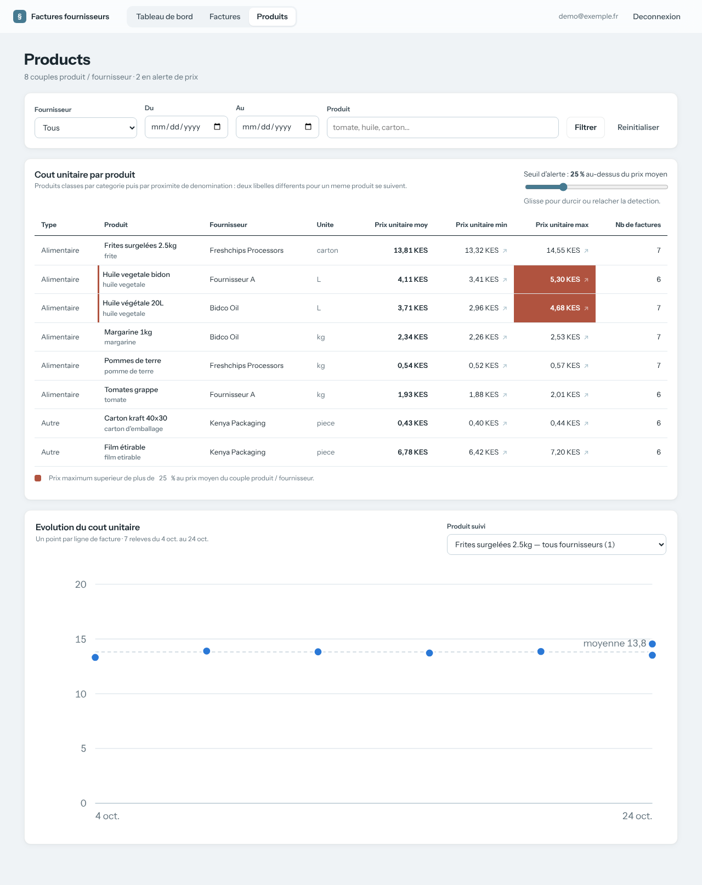

# Dashboard produits

Fait partie du [cahier des charges](../README.md) · état au 27 octobre 2026 (`main` + PR #4).

## Objectif

Comparer le prix d'un même produit dans le temps et d'un fournisseur à l'autre, et voir les hausses anormales.

## Parcours

1. L'utilisateur restreint au besoin la page par fournisseur, période ou produit.

2. Le tableau rapproche chaque produit, quel que soit son libellé chez chaque fournisseur ; les prix au-dessus du seuil sont en rouge.

3. Il règle le seuil d'alerte au curseur, puis choisit un produit pour voir l'évolution de son prix.

## Exigences

Chaque exigence indique le test du dépôt qui la vérifie, ou « non couverte ».

- **EF-PRO-1** — La page Produits doit permettre de filtrer par fournisseur, par période (du / au) et par recherche sur le nom du produit, et doit permettre de revenir sans filtre.
  - *Test :* **non couverte**
- **EF-PRO-2** — La page Produits doit regrouper les lignes de facture par produit générique, fournisseur, unité et devise, et doit les ordonner par catégorie puis par produit.
  - *Test :* **non couverte**
- **EF-PRO-3** — L'application doit traiter comme un même produit les variantes de lecture d'un même libellé chez un même fournisseur (casse, accents, pluriel, unité lue différemment), et doit signaler un groupe dont l'unité a été lue de façon incohérente.
  - *Test :* **non couverte**
- **EF-PRO-4** — L'application doit fusionner deux orthographes d'un fournisseur seulement quand les mots de l'une, formes juridiques ôtées, sont inclus dans ceux de l'autre.
  - Cette fusion ne doit s'appliquer qu'à la page Produits.
  - *Test :* **non couverte**
- **EF-PRO-5** — Pour chaque groupe, la page doit afficher le prix unitaire moyen, minimum et maximum, le nombre de factures, et un lien vers la facture du prix minimum et du prix maximum.
  - *Test :* **non couverte**
- **EF-PRO-6** — La page doit signaler les groupes dont le prix maximum dépasse la moyenne de plus d'un seuil réglable (25 % par défaut, de 0 à 100 % par pas de 5 %), sans recharger la page, et les filtres doivent conserver ce seuil.
  - *Test :* **non couverte**
- **EF-PRO-7** — La page doit afficher l'historique du prix unitaire d'un produit choisi, fournisseur par fournisseur.
  - *Test :* **non couverte**

## Règles de gestion et cas limites

- **Regroupement** : produit générique + fournisseur + unité + devise. Deux unités différentes ne sont jamais comparées.
- **Variantes** : les lignes d'un même libellé chez un même fournisseur votent pour un seul nom de produit et une seule unité.
- **Fournisseurs** : « FRESHCHIPS LIMITED » et « FRESHCHIPS PROCESSORS LIMITED » fusionnent ; « Bidco Foods » et « Bidco Oil » non.
- **Dérive** : écart du prix maximum au-dessus de la moyenne, en pourcentage ; c'est elle que compare le seuil.

## Limites connues

- La page n'a pas encore reçu la refonte visuelle des autres pages.
- Elle ne montre que les factures importées depuis l'arrivée des lignes d'articles.
- Aucun test du dépôt ne couvre cette page.
