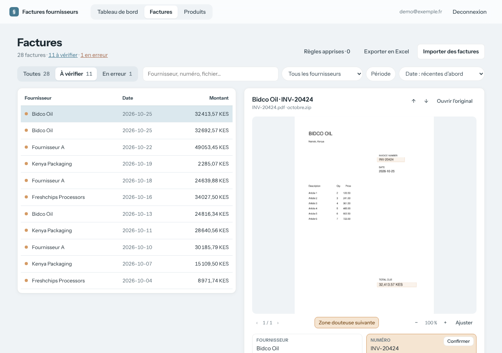
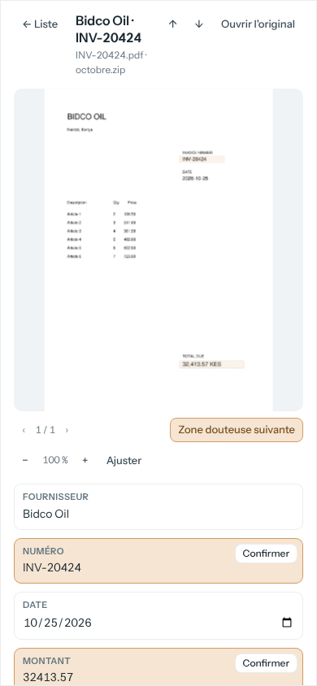

# Tableau des factures

Fait partie du [cahier des charges](../README.md) · état au 27 octobre 2026 (`main` + PR #4).

## Objectif

Retrouver n'importe quelle facture, la voir à côté de son document, et parcourir la liste au clavier comme à la souris.

## Parcours

1. La liste est à gauche ; l'utilisateur la filtre, la trie, passe d'un onglet de statut à l'autre.

2. Il sélectionne une facture : son document et ses champs s'affichent à droite. Les flèches ↑ / ↓ passent à la suivante.

3. Sur téléphone, le détail s'ouvre en plein écran avec un bouton retour.

## Exigences

Chaque exigence indique le test du dépôt qui la vérifie, ou « non couverte ».

- **EF-FAC-1** — La page Factures doit présenter la liste des factures à gauche et la facture sélectionnée à droite ; la sélection doit figurer dans l'adresse (`?id=`).
  - *Test :* `tests/test_invoice_list.py::test_page_lists_rows_with_state_and_has_detail_pane` (partielle : la sélection dans l'adresse est du JavaScript, non testé)
- **EF-FAC-2** — La page doit permettre de filtrer par recherche, fournisseur, période, statut (toutes, à vérifier, en erreur) et import, et de trier par date ou par montant, croissant ou décroissant.
  - Les compteurs des onglets de statut ignorent le filtre de statut.
  - *Test :* `tests/test_invoice_list.py::test_sort_orders_put_missing_values_last`, `tests/test_invoice_list.py::test_status_counts_ignore_the_status_filter`, `tests/test_invoice_list.py::test_status_links_keep_other_filters` (partielle : le tri, les compteurs et les liens sont testés, pas les filtres eux-mêmes)
- **EF-FAC-3** — La liste doit être paginée par 100 factures, et la pagination doit conserver filtres et tri.
  - *Test :* `tests/test_invoice_list.py::test_invoices_page_has_no_duplicates_panel_and_keeps_sort_in_pagination`
- **EF-FAC-4** — La page doit afficher le document original page par page, avec zoom (de 0,5 à 4 fois la taille ajustée), déplacement à la souris, au doigt et au clavier, et passage d'une page à l'autre.
  - *Test :* `tests/test_pages_route.py::test_pdf_page_is_rendered_as_png`, `tests/test_pages_route.py::test_page_out_of_range_is_404`, `tests/test_pages_route.py::test_api_detail_reports_pages_and_regions` (partielle : zoom et déplacement sont du JavaScript, non testé)
- **EF-FAC-5** — La page doit rester utilisable sur téléphone : le détail s'ouvre en plein écran avec un bouton retour, sans défilement horizontal de la page.
  - *Test :* **non couverte** (mise en page)

## Règles de gestion et cas limites

- **Tri** : date ou montant, croissant ou décroissant ; les valeurs manquantes vont toujours en fin de liste.
- **Sélection** : une adresse `?id=` qui ne correspond à aucune ligne de la page sélectionne la première.
- **Liste vide** : un message propose de retirer les filtres.
- La vérification des champs douteux est décrite dans [la spec Vérification](06-verification.md).

## Limites connues

- Un numéro de page non entier dans l'adresse d'une page renvoie une erreur 422 au lieu de 404.
- Un PDF dont une page ne se rend pas renvoie une erreur 500.
- « Ouvrir l'original » reste visible quand le fichier a disparu du disque.
- Après un pincement, un doigt seul ne déplace plus la page ; la visionneuse n'est pas remesurée à l'ouverture du détail sur téléphone.
- « Retirer ce filtre » efface aussi le tri et la recherche ; les flèches font défiler la liste derrière le bilan d'import.
