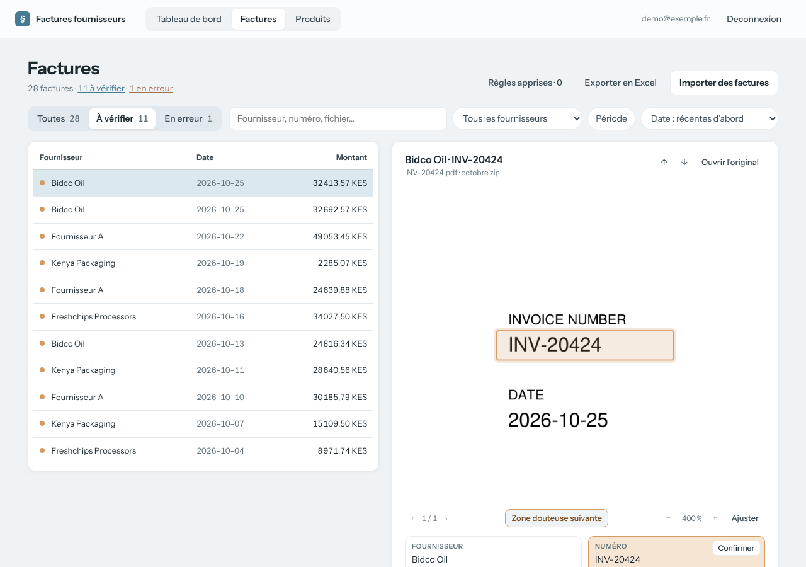

# Vérification des valeurs à vérifier

Fait partie du [cahier des charges](../README.md) · état au 27 octobre 2026 (`main` + PR #4).

## Objectif

Ne relire que ce dont l'automate doute, le voir à l'endroit exact du document, et faire servir chaque vérification aux imports suivants.

## Parcours

1. L'onglet « À vérifier » ne montre que les factures qui ont au moins un champ douteux, signalé en orange.

2. La visionneuse entoure sur le document la zone de chaque champ douteux ; « Zone douteuse suivante » la centre.

3. Pour chaque champ, l'utilisateur corrige la valeur ou la confirme ; « Valider la facture » confirme tous les champs restants.

4. Corrections et confirmations s'accumulent ; à partir de 3 en attente, l'automate en tire une règle par fournisseur, appliquée aux imports suivants.

## Exigences

Chaque exigence indique le test du dépôt qui la vérifie, ou « non couverte ».

- **EF-VER-1** — La visionneuse doit entourer sur le document la zone de chaque champ douteux, doit pouvoir centrer la zone suivante, et un clic sur une zone doit placer le curseur dans le champ correspondant.
  - *Test :* **non couverte** (JavaScript)
- **EF-VER-2** — L'utilisateur doit pouvoir corriger les six champs d'en-tête, et aucun autre champ ; la correction doit être enregistrée sur la facture dont la valeur a été saisie.
  - *Test :* `tests/test_invoice_review.py::test_correcting_a_field_removes_its_region`, `tests/test_invoice_review.py::test_confirmed_then_corrected_field_is_marked_edited` (partielle : le rattachement de la saisie à la bonne facture est du JavaScript, non testé)
- **EF-VER-3** — L'utilisateur doit pouvoir confirmer un champ douteux sans le modifier, ou valider la facture entière, ce qui confirme tous ses champs douteux ; une facture en erreur ne doit pas pouvoir être validée.
  - *Test :* `tests/test_invoice_review.py::test_confirm_removes_doubt_and_region_and_records_confirmation`, `tests/test_invoice_review.py::test_validate_confirms_every_doubtful_field`, `tests/test_invoice_review.py::test_validate_refuses_an_invoice_in_error`
- **EF-VER-4** — L'application doit enregistrer chaque correction et chaque confirmation d'un champ, avec sa valeur avant et après.
  - *Test :* `tests/test_invoice_review.py::test_confirm_removes_doubt_and_region_and_records_confirmation` (partielle : l'enregistrement d'une correction n'est vérifié qu'indirectement)
- **EF-VER-5** — L'application doit déduire des corrections et confirmations en attente une règle d'extraction par fournisseur (plus une règle globale), et doit affiner la règle existante plutôt que d'en ajouter une nouvelle.
  - *Test :* `tests/test_learning.py::test_confirmations_are_described_as_such`, `tests/test_learning.py::test_rule_prompt_explains_confirmations` (partielle : la consigne envoyée seulement, pas l'affinage d'une règle)
- **EF-VER-6** — L'application doit lancer cet apprentissage automatiquement dès que 3 corrections ou confirmations sont en attente (`AUTO_LEARN_THRESHOLD`), et doit aussi permettre de le lancer à la main.
  - *Test :* `tests/test_invoice_review.py::test_confirmations_reach_the_learning_threshold`
- **EF-VER-7** — L'application doit marquer comme traitées toutes les corrections analysées, même celles dont aucune règle n'a pu être tirée.
  - *Test :* **non couverte**
- **EF-VER-8** — L'utilisateur doit pouvoir consulter et supprimer les règles apprises.
  - *Test :* **non couverte**

## Règles de gestion et cas limites

- Les champs douteux et leurs zones viennent de l'import (`EF-IMP-15`, `EF-IMP-16`).
- Une correction efface le doute et la zone du champ, et le marque « corrigé » (vert).
- Une confirmation efface le doute sans changer la valeur ; elle est enregistrée comme « signalée douteuse, confirmée exacte », pour qu'une règle puisse dire de ne plus douter de ce champ chez ce fournisseur.
- Une saisie commencée sur une facture reste attachée à cette facture, même si l'utilisateur passe à la suivante avant la fin de l'enregistrement.
- Les règles sont affinées, pas empilées : une seule par fournisseur, plus une globale.

## Limites connues

- L'effet des règles sur le nombre d'erreurs n'a pas été mesuré.
- Deux confirmations très rapides peuvent se chevaucher, et les boutons ne sont pas désactivés pendant l'enregistrement.
- Un champ confirmé puis corrigé envoie les deux signaux à l'apprentissage.
- Le surlignage d'une zone ne s'efface pas quand la souris la quitte.
- Le serveur accepte une confirmation sur une facture en erreur ; seule l'interface l'empêche.
